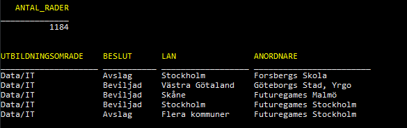
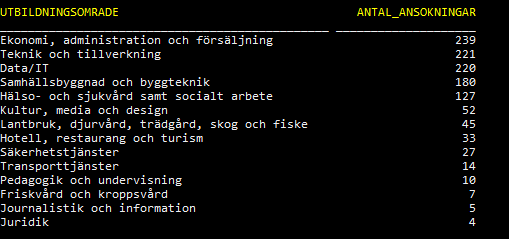
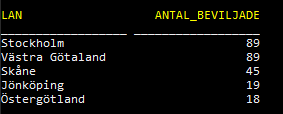
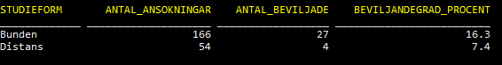
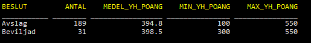
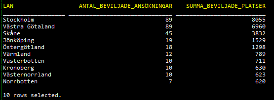
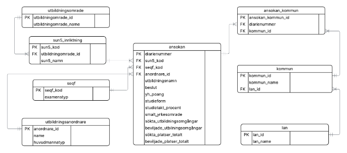
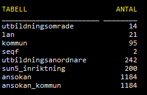

# The Skool – YH-ansökningar 2025

SQL-labb som hjälper **The Skool** att fatta datadrivna beslut utifrån
MYH:s beslut om YH-ansökningar (ansökningsomgång 2025).

## Kom igång

```bash
# 1. Ladda data
orac 00_load/0_create_table.sql
orac 00_load/1_load_csv.sql
# Förväntat: ANTAL_RADER = 1184

# 2. EDA (uppgift 1)
orac 01_eda/1a_antal_per_utbildningsomrade.sql

# 3. Egna frågor (uppgift 3)
orac 02_datadrivna_beslut/3_datadrivna_beslut.sql

# 4. Datamodell (uppgift 4, bonus)
orac 03_datamodell/1_create_tables.sql
orac 03_datamodell/2_load_data.sql
orac 03_datamodell/3_uppgift1.sql
```



## Uppgift 1 – EDA

| Skript | Fråga |
| ------ | ----- |
| 1a | Antal ansökningar per utbildningsområde |
| 1b | Beviljade per utbildningsområde |
| 1c | Avslag per utbildningsområde |
| 1d–1f | Data/IT: beviljade och avslag per namn/anordnare |
| 1g | Topp 5 län efter beviljade |
| 1h | Andel bunden vs distans |
| 1i | Utbildningar som innehåller ordet AI (48 st) |

Flest ansökningar: Ekonomi (239), Teknik (221), Data/IT (220).



Topp 5 län efter beviljade.



## Uppgift 3 – Datadrivna beslut

SQL: `02_datadrivna_beslut/3_datadrivna_beslut.sql`

**Distans vs bunden (Data/IT)** 



**YH-poäng beviljade vs avslag** – Medelpoängen är nästan densamma
(~395–399). Programlängd skiljer knappt; fokusera på andra faktorer.



**Beviljade platser per län** – Stockholm och Västra Götaland får störst
volym. Underlag för var The Skool bör prioritera.



## Uppgift 4 – Datamodell

Bryter upp `ansokningar` i åtta tabeller enligt ER-diagrammet.
Samma frågor som uppgift 1 körs sedan med JOIN mot de nya tabellerna.



Efter laddning: 1184 ansökningar, 95 kommuner, 242 anordnare, 200 SUN5-koder.



## Struktur

```
00_load/                 Staging-tabell + CSV
01_eda/                  Uppgift 1
02_datadrivna_beslut/    Uppgift 3
03_datamodell/           Uppgift 4
screenshots/
```
